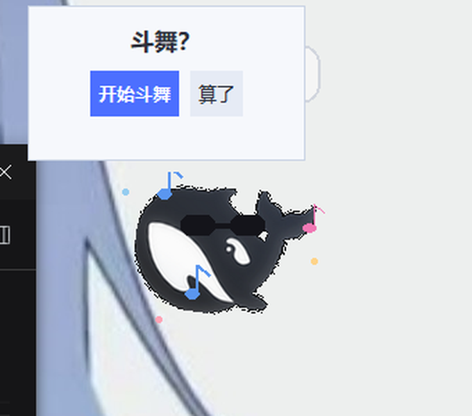
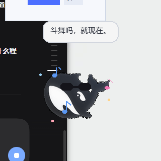
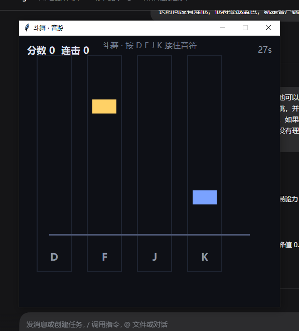
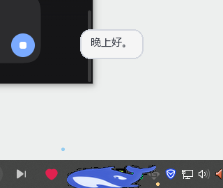
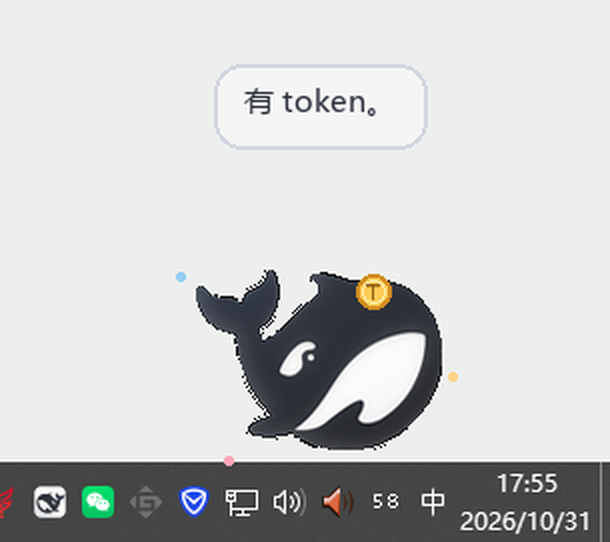

# 深海鲸鱼桌宠 · DeepSeek Whale Pet 🐋

[](https://github.com/zhuhsjai/deepseek-whale-pet)
[](https://github.com/zhuhsjai/deepseek-whale-pet)
[](LICENSE)
[](https://github.com/zhuhsjai/deepseek-whale-pet/releases)

从 DeepSeek 客户端图标里抠出来的小鲸鱼，住在你的 Windows 桌面上。

会游泳、会耍宝、知道时间和天气、能吃 token、**听到音乐就戴墨镜跳舞并邀请你斗舞**（内置 4 键音游），还会察觉你什么时候在打游戏、多久没理它。



> Windows 10 / 11 · Python 3.10+ · 纯本地运行，只有一个可选的天气请求

## 特性

- 🐋 **透明无边框、永远置顶**：只留鲸鱼本体，不占任务栏，可随意拖拽
- 🎵 **听歌跳舞**：读取系统音频峰值，检测到任何程序在放歌 → 戴墨镜、左右跳、飘音符 → 弹「斗舞？」邀请
- 🎮 **内置音游**：D / F / J / K 四键节奏游戏，分数 / 连击 / 30 秒倒计时 / 命中音效；游玩时 D/F/J/K 全局接管，不会漏进输入框
- 🕹 **游戏察觉**：检测前台全屏游戏（如光遇、Steam 游戏）→ 自动缩小、站到角落不打扰；切回来恢复
- 💤 **久置没电**：2.5 分钟没人理 → 变蓝；4 分钟 → 变扁贴底；碰一下恢复
- 🪙 **吃 token**：身边随机飘出金色 token，游过去吃掉；右键可喂，计数持久化
- 🌤 **天气**：自动定位 + open-meteo 当日预报，下雨下雪会提醒
- 🕐 **知道时间**：报时、按时段问候、深夜提醒睡觉
- 🤚 **更多互动**：摸头、跳舞、唱歌、翻跟头、跟随鼠标

## 截图

| 听歌跳舞 / 斗舞邀请 | 音游 |
|---|---|
|  |  |

| 玩游戏时缩小站岗 | 久置变蓝变扁 |
|---|---|
|  |  |

| 吃 token |
|---|
|  |

## 安装

需要 **Windows 10/11** 和 **Python 3.10+**（安装时勾选 Add Python to PATH）。

```bat
:: 1. 安装依赖
install.bat
:: 或手动：pip install -r requirements.txt

:: 2. 启动
start-pet.cmd
```

想放到桌面：右键 `start-pet.cmd` → 发送到 → 桌面快捷方式。

> 如果启动失败，双击 `run-console.cmd` 可以看到具体报错。

## 交互

| 操作 | 反应 |
|---|---|
| 按住拖动 | 搬到任意位置（会记住） |
| 单击 | 摸摸头（爱心） |
| 双击 | 喷水 |
| 右键 | 菜单：现在几点了 / 天气 / 喂 token / 摸摸头 / 跳舞 / 唱歌 / 翻跟头 / 斗舞 / 睡觉 / 睡觉 / 跟随鼠标 / 退出 |

音游里：**D F J K** 接音符，**ESC** 退出。

## 配置

- `config.json`（自动生成）：定位到的城市与经纬度。想固定城市，写 `{"city": "武汉"}` 再启动。
- `pet_pos.json`：上次位置
- `pet_tokens.json`：token 计数
- `weather_cache.json`：天气缓存（30 分钟）
- 想换形象：替换 `assets/my_icon.png`（会自动抠出深色主体作为桌宠）

## 工作原理

- **窗口**：tkinter 无边框窗口 + `-transparentcolor` 色键透明 + 置顶
- **形象**：Pillow 从应用图标中提取主体（连通域 + 空洞填充），预生成各状态帧
- **听歌**：`pycaw` 读取系统所有音频会话的峰值，持续超过阈值即认为在放歌
- **游戏察觉**：Win32 读取前台窗口进程名与尺寸，全屏且非日常软件白名单 → 视为游戏
- **斗舞**：Win32 低级键盘钩子（`WH_KEYBOARD_LL`）在音游期间截获并屏蔽 D/F/J/K
- **天气**：ipwho.is 定位 → open-meteo 预报（仅启动时和每 30 分钟各一次）
- **时间**：本地系统时间

## 已知限制

- 仅支持 **Windows**（依赖 Win32 API 与色键透明）
- 图标来自 DeepSeek 桌面客户端，**鲸鱼 logo 版权归 DeepSeek 所有**，本项目为非官方个人作品，详见 [NOTICE.md](NOTICE.md)；不喜欢可以自己替换 `assets/my_icon.png`
- 听歌检测依赖 `pycaw`；未安装时该功能自动静默
- 部分带反作弊的游戏可能对全局键盘钩子敏感；本项目只在音游窗口打开时启用该钩子

## 开发调试

启动时的环境变量钩子（方便测试，不影响正常使用）：

| 变量 | 作用 |
|---|---|
| `PET_TEST_MUSIC=1` | 强制进入听歌跳舞状态 |
| `PET_TEST_RHYTHM=1` | 启动后直接打开音游 |
| `PET_TEST_FLAT=1` | 快速进入「没人理」状态 |
| `PET_TEST_BLUE=1` | 强制变蓝/变扁（忽略真实音乐） |
| `PET_TEST_GAME=1` | 强制游戏缩小站岗模式 |
| `PET_TOKEN_NOW=1` | 立刻生成一枚 token |
| `PET_DEBUG=1` | 打印 tick 异常 |
| `PET_HOOK_DEBUG=1` | 键盘钩子调试日志 |

## English

A tiny whale desktop pet for Windows, extracted from the DeepSeek app icon.
It swims around, knows the time/weather, eats tokens, **detects any music playing on the system → puts on sunglasses, dances and invites you to a 4-key rhythm game (D/F/J/K)**, shrinks and hides when you're playing a game, and turns blue/flat when ignored for too long.

Windows 10/11 + Python 3.10+. `pip install -r requirements.txt`, then run `start-pet.cmd`.

Unofficial hobby project. The whale logo belongs to DeepSeek (see [NOTICE.md](NOTICE.md)).

## License

[MIT](LICENSE)（仅代码；第三方图标见 NOTICE）
---

**仓库**：<https://github.com/zhuhsjai/deepseek-whale-pet> · **下载**：<https://github.com/zhuhsjai/deepseek-whale-pet/releases>